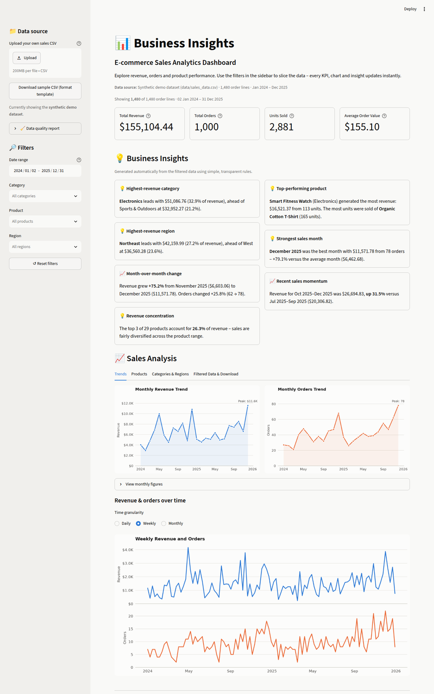

# 📊 Business Insights — E-commerce Sales Analytics Dashboard

An interactive sales analytics dashboard built with **Python, Streamlit, Pandas, NumPy and Matplotlib**.
It turns a CSV of e-commerce orders into KPIs, trend charts, product and regional breakdowns, and
automatically generated, data-driven business insights. You can explore the bundled demo dataset or
upload your own file.



> **Note:** The bundled dataset is **synthetic demo data** created by a script. It does not describe
> any real business, customer or person.

---

## Table of contents

- [Project overview](#project-overview)
- [Problem statement](#problem-statement)
- [Features](#features)
- [Technologies used](#technologies-used)
- [Dashboard capabilities](#dashboard-capabilities)
- [Dataset information](#dataset-information)
- [Project structure](#project-structure)
- [Installation and running (Windows)](#installation-and-running-windows)
- [Installation and running (macOS / Linux)](#installation-and-running-macos--linux)
- [Uploading your own CSV](#uploading-your-own-csv)
- [Expected CSV format](#expected-csv-format)
- [Running the tests](#running-the-tests)
- [Future improvements](#future-improvements)

---

## Project overview

**Business Insights** is a self-contained analytics app. It runs entirely on your own computer, needs no
database, no API keys and no paid services. The code is split into small, testable modules:

- **Data processing** (`utils/data_processing.py`): reading, validating, cleaning and filtering data
- **Analysis** (`analysis/sales_analysis.py`): KPIs, aggregations and rule-based insights
- **Charts** (`utils/charts.py`): consistent Matplotlib visualizations
- **UI** (`app.py`): the Streamlit layout that ties everything together

## Problem statement

Small online shops often have their sales history in a spreadsheet export but no easy way to answer
everyday questions such as:

- How much revenue did we make, and is it growing or shrinking?
- Which products, categories and regions drive the business?
- Which month was strongest, and how did the latest month compare with the one before?

This project answers those questions in one place. It works on any CSV that follows a simple format,
and it explains its findings in plain English. Every number is calculated from the data.

## Features

- **KPI cards**: Total Revenue, Total Orders, Units Sold, Average Order Value
- **Interactive sidebar filters**: date range, category, product and region, plus a **Reset filters** button
- **7 visualizations**: monthly revenue trend, monthly orders trend, revenue by category, top 10 products by
  revenue, top 10 products by units sold, revenue by region, and a revenue and orders trend with
  daily, weekly or monthly granularity
- **Automatic business insights**: top category, top product, top region, strongest month, month-over-month
  change, 3-month momentum and revenue concentration. All are rule-based and computed from the filtered data.
- **CSV upload** with validation, column-name normalization, date and number parsing, and friendly error messages
- **Data quality report** that shows exactly which rows were fixed or removed during cleaning
- **Download** of the currently filtered data as CSV
- **Graceful empty and error states**: invalid files, missing columns and filters that match nothing
- **Automated tests** for the data processing, the analysis and the Streamlit app itself

## Technologies used

| Tool | Purpose |
|---|---|
| Python 3.10+ | Programming language |
| [Streamlit](https://streamlit.io/) | Web dashboard framework |
| [Pandas](https://pandas.pydata.org/) | Data loading, cleaning and aggregation |
| [NumPy](https://numpy.org/) | Synthetic data generation and numeric operations |
| [Matplotlib](https://matplotlib.org/) | Charts |
| [pytest](https://pytest.org/) | Automated tests |

All libraries are free and open source.

## Dashboard capabilities

| Section | What it shows |
|---|---|
| **Header** | Project title, description and the active data source |
| **KPI cards** | Total Revenue · Total Orders (distinct order IDs) · Units Sold · Average Order Value (revenue ÷ orders) |
| **Business Insights** | Up to seven plain-English findings. When there is not enough data for one (for example, fewer than two complete months), the card says so instead of guessing. |
| **Trends tab** | Monthly revenue, monthly orders, and revenue and orders over time (daily, weekly or monthly) |
| **Products tab** | Top 10 products by revenue and by units sold, plus a full product table |
| **Categories & Regions tab** | Revenue by category and by region with revenue share |
| **Filtered Data & Download tab** | The filtered rows and a **Download filtered data (CSV)** button |
| **Sidebar** | CSV upload, sample CSV download, data quality report, filters and reset |

Notes on the insights:

- **Partial months:** if the selected date range ends partway through a month, that month is left out
  of the growth comparisons so a half-finished month doesn't look like a drop.
- **Revenue and orders chart:** revenue and orders are drawn as two stacked panels that share a time
  axis, not as one chart with two y-axes, so neither measure is visually distorted.

## Dataset information

The sample file is `data/sales_data.csv`. It is **synthetic**: generated by
`scripts/generate_sample_data.py` with a fixed random seed. See [`data/README.md`](data/README.md) for details.

- 1,480 order lines, 1,000 orders (some orders contain several products)
- 2 Jan 2024 to 31 Dec 2025
- 29 products in 6 categories: Electronics, Home & Kitchen, Clothing, Sports & Outdoors,
  Beauty & Personal Care, Books
- 5 regions: Northeast, Southeast, Midwest, Southwest, West
- Realistic patterns: holiday peaks, gradual growth, promotional discounts

To regenerate it: `python scripts/generate_sample_data.py`

## Project structure

```
Business-Insights/
│
├── app.py                        # Streamlit dashboard (UI only)
│
├── data/
│   ├── sales_data.csv            # Synthetic demo dataset
│   └── README.md                 # Notes about the demo data
│
├── analysis/
│   ├── __init__.py
│   └── sales_analysis.py         # KPIs, aggregations, business insights
│
├── utils/
│   ├── __init__.py
│   ├── data_processing.py        # Load, validate, clean, filter, export
│   ├── charts.py                 # Matplotlib chart builders
│   └── formatting.py             # Currency / number / percent formatting
│
├── scripts/
│   └── generate_sample_data.py   # Recreates data/sales_data.csv
│
├── tests/
│   ├── test_data_processing.py   # Cleaning, validation, filtering tests
│   ├── test_sales_analysis.py    # KPI, aggregation and insight tests
│   └── test_app.py               # Headless end-to-end tests of the dashboard
│
├── docs/
│   └── dashboard.png             # Screenshot used in this README
│
├── .streamlit/
│   └── config.toml               # Dashboard theme (no secrets)
│
├── pytest.ini
├── requirements.txt
├── README.md
└── .gitignore
```

---

## Installation and running (Windows)

### 1. Install Python

Download Python 3.10 or newer from [python.org](https://www.python.org/downloads/).
During installation, tick **"Add python.exe to PATH"**.

Check it works by opening **PowerShell** and running:

```powershell
python --version
```

### 2. Get the project

If you have Git installed:

```powershell
git clone https://github.com/haripriyamanga/Business-Insights.git
cd Business-Insights
```

Or download the ZIP from GitHub (**Code → Download ZIP**), extract it, and `cd` into the extracted folder.

### 3. Create a virtual environment

A virtual environment keeps this project's packages separate from the rest of your computer.

```powershell
python -m venv .venv
```

### 4. Activate the virtual environment

```powershell
.\.venv\Scripts\Activate.ps1
```

You should now see `(.venv)` at the start of your prompt.

> **If you get an error saying "running scripts is disabled on this system"**, run this once and then try
> activating again:
>
> ```powershell
> Set-ExecutionPolicy -ExecutionPolicy RemoteSigned -Scope CurrentUser
> ```
>
> If you use **Command Prompt (cmd)** instead of PowerShell, activate with `.venv\Scripts\activate.bat`.

### 5. Install the dependencies

```powershell
pip install -r requirements.txt
```

### 6. Run the dashboard

```powershell
streamlit run app.py
```

Your browser should open at **http://localhost:8501**. If it doesn't, copy that address into your browser.
To stop the app, press **Ctrl + C** in the terminal.

Next time, you only need to open PowerShell in the project folder, activate the environment
(step 4) and run the app (step 6).

## Installation and running (macOS / Linux)

```bash
python3 -m venv .venv
source .venv/bin/activate
pip install -r requirements.txt
streamlit run app.py
```

---

## Uploading your own CSV

1. Start the dashboard.
2. In the sidebar under **📁 Data source**, click **Upload** (or drag a file onto the box).
3. Choose a `.csv` file. The dashboard validates and cleans it, and all KPIs, charts and insights switch
   to your data.
4. Open **🧹 Data quality report** in the sidebar to see what was cleaned (for example, rows with invalid
   dates that were removed).
5. To go back to the demo data, remove the uploaded file with the **✕** next to its name.

If the file can't be used (for example, a required column is missing), a clear error message explains why
and the dashboard keeps showing the sample data. Not sure about the format? Click
**Download sample CSV (format template)** in the sidebar.

## Expected CSV format

The first row must contain column headers. Headers are **not case-sensitive**, and spaces, dashes and
underscores are treated the same, so `Order Date`, `order_date` and `ORDER-DATE` all work.

| Column | Required? | Example | Notes |
|---|---|---|---|
| **Order ID** | Optional | `ORD-10001` | Several rows may share an ID (one order, many products). If missing, each row counts as its own order. |
| **Order Date** | ✅ Required | `2025-03-14` | Most formats work (`2025-03-14`, `03/14/2025`, `14 Mar 2025`). Invalid dates are removed. |
| **Product** | ✅ Required | `Wireless Earbuds Pro` | Rows with no product name are removed. |
| **Category** | Optional | `Electronics` | Missing values become `Unknown`. |
| **Region** | Optional | `West` | Missing values become `Unknown`. |
| **Quantity** | ✅ Required | `2` | Must be a number greater than 0. |
| **Unit Price** | ✅ One of these two | `89.99` | Currency symbols and thousands separators are fine (`$1,299.00`). |
| **Revenue** | ✅ One of these two | `179.98` | If missing, it is calculated as Quantity × Unit Price (and vice versa). |

Example:

```csv
Order ID,Order Date,Product,Category,Region,Quantity,Unit Price,Revenue
ORD-10001,2024-01-02,Stainless Steel Cookware Set,Home & Kitchen,Southeast,4,129.99,519.96
ORD-10002,2024-01-03,Mindful Productivity Guide,Books,Northeast,2,16.99,33.98
```

Common alternative names are recognized automatically, for example `Date`, `Item`, `Qty`, `Price`,
`Sales` and `Amount`. Comma-, semicolon- and tab-separated files are supported, as are UTF-8 and
Windows (cp1252 / Latin-1) encodings.

**What cleaning does:**

- Normalizes column names
- Parses dates and numbers
- Removes rows with invalid dates, missing products or non-positive quantities
- Fills missing category and region with `Unknown`
- Removes exact duplicate rows
- Reports every change in the data quality report

---

## Running the tests

With the virtual environment activated, run this from the project folder:

```powershell
python -m pytest
```

You should see all tests pass. The suite covers:

- **Data processing:** column normalization, currency parsing, invalid dates and numbers, duplicates,
  missing values, derived revenue and price, missing columns, empty files, delimiter and encoding
  detection, filtering, and CSV export round-trip
- **Analysis:** KPI values (including multi-product orders), monthly gap-filling, category, region and
  product rankings, month-over-month growth, partial-month handling, and insights on empty or tiny data
- **App:** headless runs of the real Streamlit app (using Streamlit's `AppTest`) that check the KPIs
  render, filters update the numbers, the "no results" state and reset work, and every chart granularity
  renders without errors

## Future improvements

- Interactive charts (hover tooltips and zoom) with a library such as Altair or Plotly
- Period-over-period deltas on the KPI cards (for example, versus the previous period)
- Customer-level analytics (repeat purchase rate, cohort retention) when customer IDs are available
- Profit and margin analysis when cost data is available
- Simple sales forecasting (for example, a seasonal baseline)
- Exporting an insights summary as a PDF report
- Deployment to Streamlit Community Cloud
